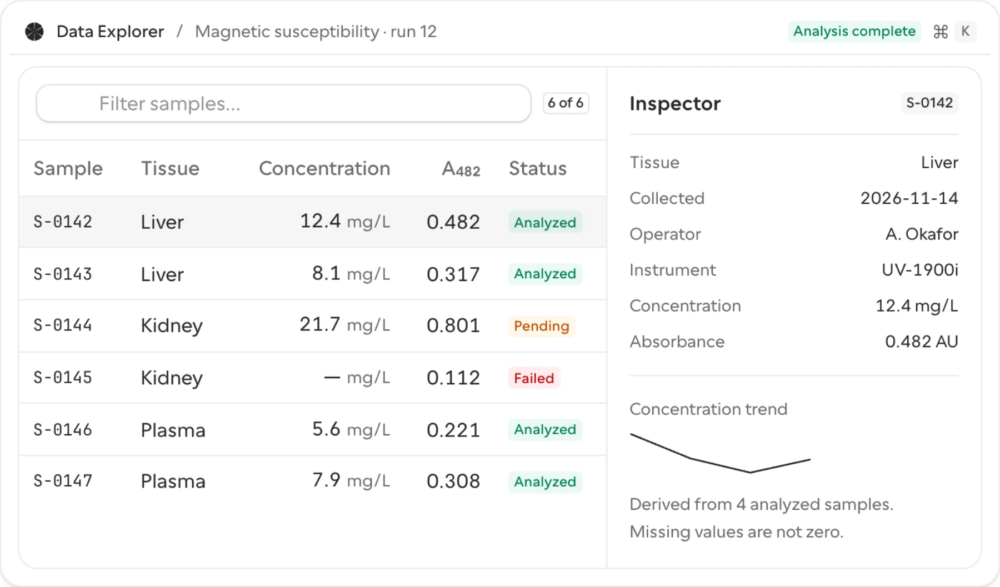
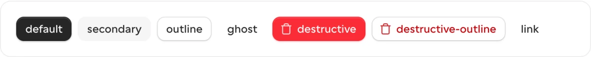
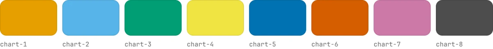
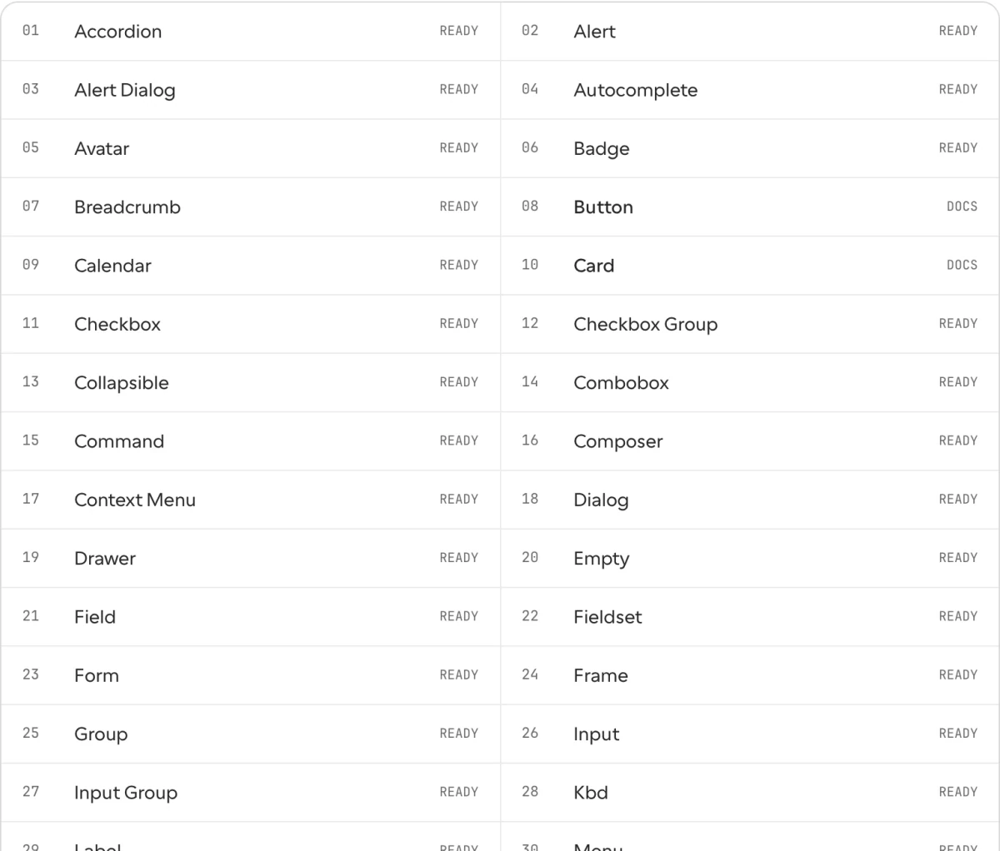
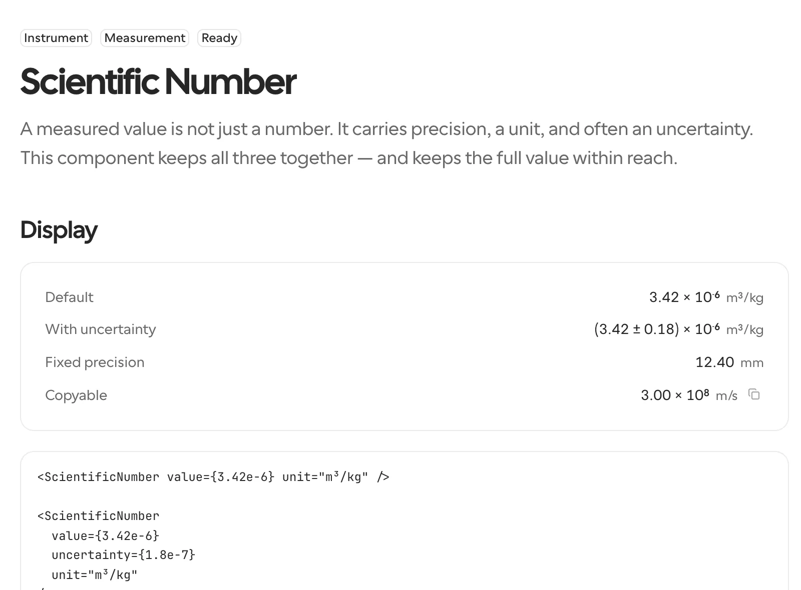
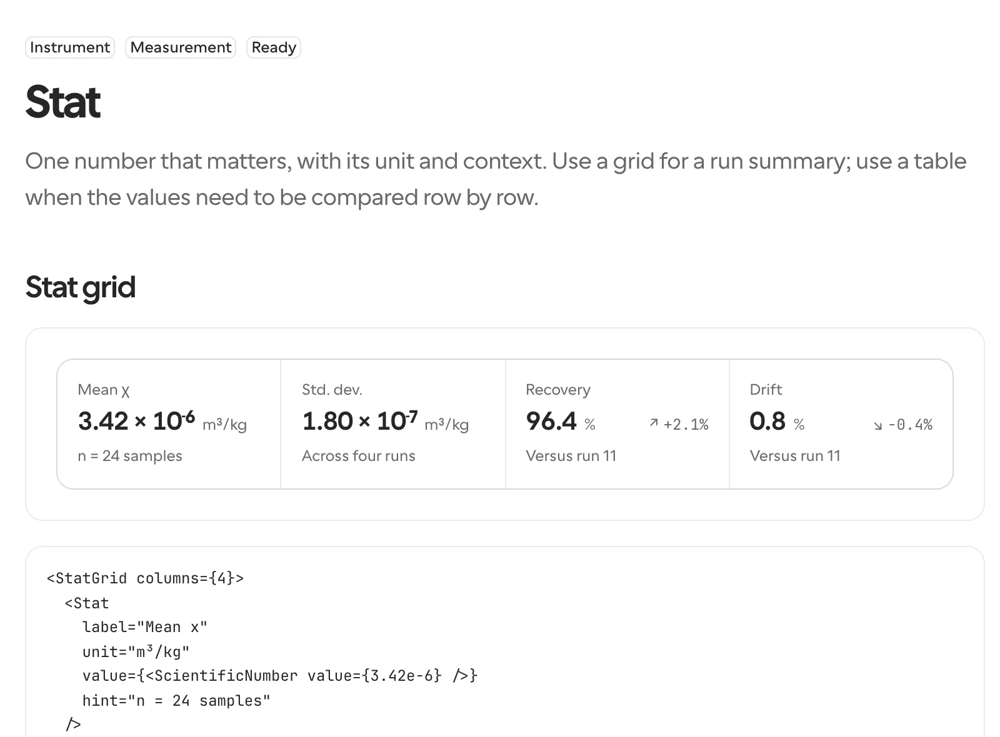
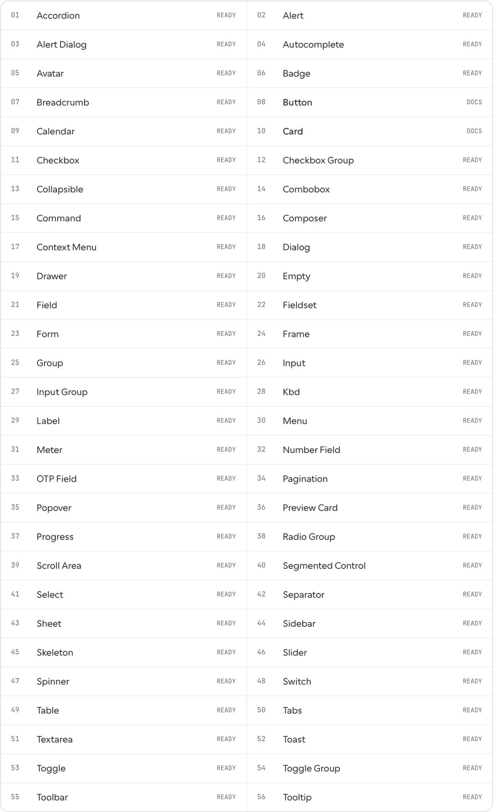

<div align="center">


<br />
<br />

[](./PLAN.md)
[](./LICENSE)
[](./registry/default/ui)
[](./apps/web/test)
[](https://react.dev)
[](https://tailwindcss.com)
[](https://typescriptlang.org)

**A copy-paste UI system for scientific software.**<br />
Elements, instruments, and whole workbenches — so you spend your time on the science.

[**Live site**](https://abhinav-prabhakar.github.io/Aperture/) · [**Elements**](https://abhinav-prabhakar.github.io/Aperture/docs/elements/) · [**Design contract**](./design.md) · [**Catalog**](./docs/catalog.md)

</div>

---

## A workbench, not a widget demo



A table with units. An inspector with provenance. Missing values that read as missing, not zero. This is the whole idea: researchers should not rebuild the same instrument panel in every lab.

## Three layers. One system.


**56 elements** · **4 of 12 instruments ready** · **4 workbenches** — one design contract from the first button to the finished screen.

## Details researchers notice

<p align="center">
  
  
</p>

<p align="center">
  
  
</p>

Units live with the value. Uncertainty is a first-class input. The chrome is achromatic, so color is reserved for data and status. Tabular numerals, true minus signs, explicit missing values.

## Built for the bench and the field

<p align="center">
  
  
</p>

Life sciences first — sample tables, plate readers, growth curves, dose–response, PCR programs, reagent inventory. The same grammar extends to physics, astronomy, chemistry, earth science, social science, economics, and the humanities.

## The first four instruments

<p align="center">
  
  
</p>

<p align="center">
  
  
</p>

Live in the registry with docs, tests, and accessible names: `quantity-input`, `scientific-number`, `stat`, `sparkline`. The other eight are in progress against the same contract.

## Light. Dark. Every screen.


<p align="center">
  
</p>

One token contract across three themes and every screen size. Keyboard-first, screen-reader-aware, reduced-motion-safe, RTL-ready.

## Install

Point shadcn at the hosted registry:

```json
{
  "registries": {
    "@aperture": "https://abhinav-prabhakar.github.io/Aperture/r/{name}.json"
  }
}
```

Add the token sheet, then any element:

```bash
curl -o app/aperture.css https://abhinav-prabhakar.github.io/Aperture/aperture.css
npx shadcn@latest add @aperture/button
```

Every component lands in your repository. You own the code.

## Status

Phase 1: elements, tokens, registry, docs, `@aperture/quantities`, and four founding instruments are in place. The remaining instruments and the workbenches are next. Counts and commands on the site describe the target, not a finished release.

---

<div align="center">
<sub>

Built on [coss/ui](https://coss.com/ui) by the team at Cal.com, with [Base UI](https://base-ui.com), [Tailwind CSS](https://tailwindcss.com), and [shadcn/ui](https://ui.shadcn.com).<br />
Cal Sans and JetBrains Mono are used under the SIL Open Font License. MIT licensed.

**[Aperture is not affiliated with or endorsed by Cal.com or coss.com.](./THIRD_PARTY_NOTICES.md)**

</sub>
</div>

<details>
<summary><sub>See the whole page</sub></summary>
<br />

</details>

<details>
<summary><sub>All 56 elements</sub></summary>
<br />
<p align="center">
  
</p>
</details>
